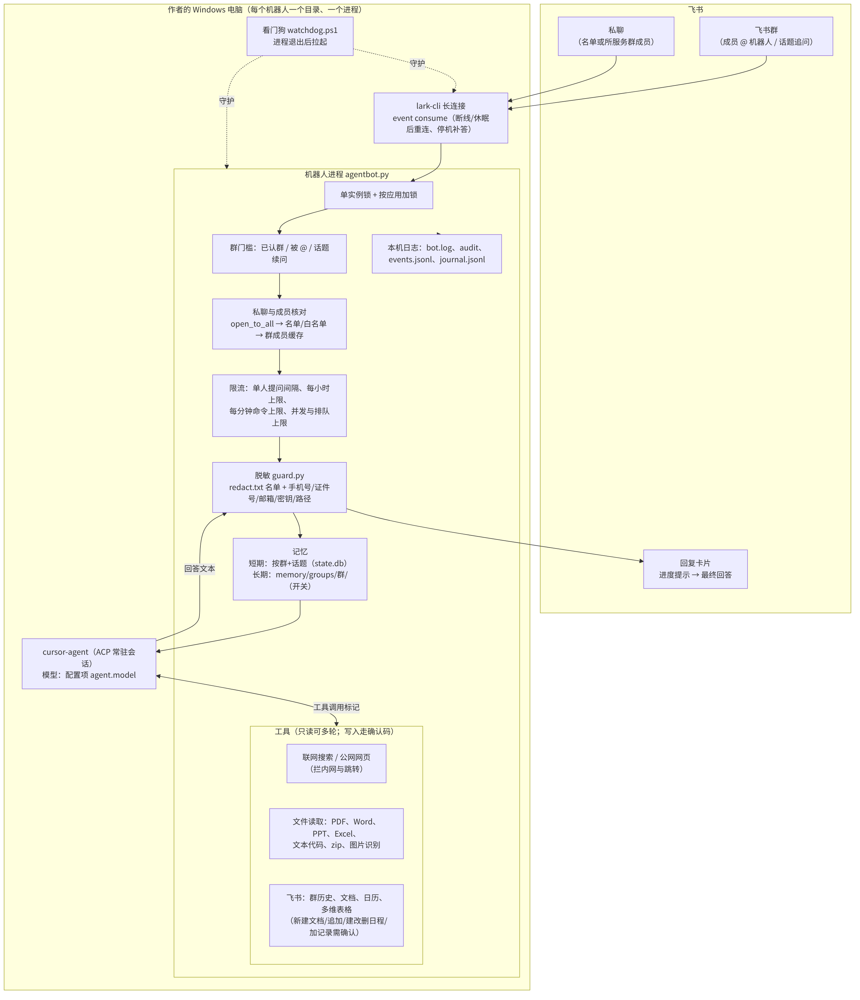
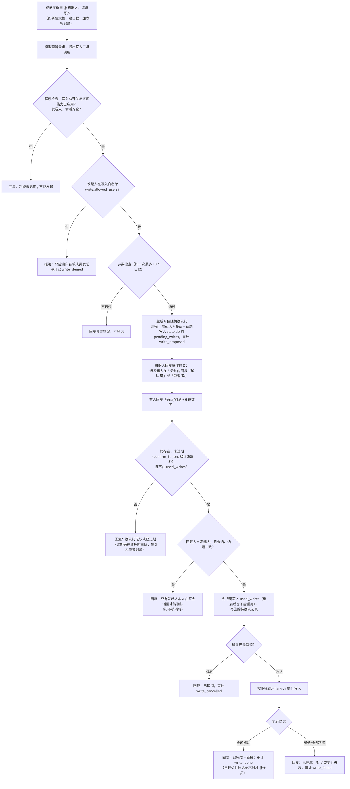

# 终树展示位提案

状态：只提案。本文件不实现页面，不改导航，不改作品目录。

## 结论

幕景宇宙仍然是**林丽丽的艺术家站点**。丁科智（终树）是团队的经纪人与管理者，放在工作室之下，不与艺术家并列。

| | 林丽丽 | 丁科智（终树） |
| --- | --- | --- |
| 对外身份 | 艺术家 · 主理人 | 经纪人 · 团队管理 |
| 站点里的位置 | 顶栏「艺术家」，`/artist/` | 工作室下的一页，`/studio/zhongshu/` |
| 不承担 | 商务对接的第一入口（那是合作页） | 创作署名、作品版权、字标 |

若团队希望终树也带「主理」，写成**经纪与管理主理**，不要写成与林丽丽并列的「主理人」。工作室页上林丽丽保持「艺术家 · 主理人」。

## 参照

成熟画廊把艺术家放在主导航，把人和经纪放在 About 或 Contact：

- [Hauser & Wirth · Artists & Estates](https://www.hauserwirth.com/artists/) 是艺术家名单。画廊自身在 [About](https://www.hauserwirth.com/about/)。询价与对接在 [Contact Us](https://www.hauserwirth.com/contact-us/)，不在艺术家名单里加一列员工。
- Pace、Lisson、White Cube 同样：主导航是 Artists，代理与联系在 About / Contact。
- 单人工作室更接近我们。[Studio Olafur Eliasson](https://olafureliasson.net/biography/) 的作品导航是 Artworks。团队在 [About Studio](https://olafureliasson.net/studio/)，按职务列在艺术家之下，不成为第二个站名。

对应到幕景：顶栏继续是作品、艺术家、合作。终树是工作室里的经纪人，不是第二位艺术家，也不是站名的另一半。

## 建议网址

`/studio/zhongshu/`

- 英文 slug，与现有 `/artist/`、`/studio/`、`/contact/` 一致。
- 挂在工作室下面，打开地址就能看出从属，而不是和 `/artist/` 平级的 `/zhongshu/`。
- 实现时用 `src/pages/studio/zhongshu.astro`（本提案不做）。`trailingSlash: 'always'`，公开地址带结尾斜线。

不要用 `/team/` 做顶层。现在只有两个人，单独开一个与「艺术家」平级的「团队」会把经纪人和创作者放成同一层。

## 导航

顶栏保持现在的三项，不增加「终树」或「团队」：

- 作品 → `/works/`
- 艺术家 → `/artist/`
- 合作 → `/contact/`

页脚保持：作品、艺术家、工作室、合作。工作室这一项已经够用，不必再加一条。

两条入口，都是正文里的链接，不是主导航：

1. `/studio/` 丁科智那张成员卡，现在没有链接。加上「经纪页 →」，指向 `/studio/zhongshu/`。林丽丽那张卡继续只链到 `/artist/`。
2. `/contact/`「经纪 · 商务（首选）」卡片加上同一条链接。合作页仍然是对外对接的地方；经纪人页说明他是谁、工作室用什么系统，不替代合作页。

```
顶栏   作品    艺术家（林丽丽）    合作
页脚   作品    艺术家    工作室    合作
                         │
                         └─ /studio/  林丽丽（主卡）→ /artist/
                                      丁科智（次卡）→ /studio/zhongshu/
                         /contact/ 经纪卡 → /studio/zhongshu/
```

## 版式

沿用工作室页和合作页，不新做一套视觉。

- 底是纸色 `#F6F5F3`，居中窄栏，与 `/studio/` 相同。
- 眉题（kicker）：`Representation · 经纪`。字号、字距与合作页眉题一致。
- 标题：宋体 / 衬线，`丁科智（终树）`。字号不超过艺术家页姓名，不大于工作室页「以艺术家为核心的工作室」。
- 标题下一条角色：`经纪人 · 团队管理`。用现有 cap 样式，不要用比林丽丽更大的字。
- 一段短介绍，然后四条职责，卡片样式直接复用合作页的四格服务（01–04），文案改成「他对接什么」，不写成作品介绍。
- 两个药丸按钮：`看艺术家` → `/artist/`，`谈合作` → `/contact/`。艺术家按钮在前。
- 职责区下面才是二级标题 **Team systems / 团队系统**。这一区更安静：字号小于姓名，不用首页精选环。两张示意图留在窄栏里，宽度不超过正文，不放大成作品图。

手机（390 宽）单列。姓名、角色、按钮的点击高度至少 44px。这一页没有自动播放的声音或视频。

## 文案草稿

眉题：Representation · 经纪

标题：丁科智（终树）

角色：经纪人 · 团队管理

正文：

> 丁科智，工作室对外称终树，负责艺术家林丽丽的经纪与团队管理。浙江音乐学院硕士在读，参与音画线的声音部分。展览、委托与商务合作，由他统一对接。
>
> 创作与作品版权归林丽丽。终树安排作品如何抵达展厅、城市与公众，不替代艺术家创作。

职责（与 `/contact/` 的四项对齐，只写对接）：

1. 展览与展陈 — 美术馆、文旅与景区的音画展陈、长卷委托，由经纪人对接。
2. 作品委托 — 品牌与机构的定制视觉、音画，由经纪人对接。
3. 产品与游戏合作 — AIGC 产品、游戏与数字场景的合作意向，由经纪人对接。
4. 讲座与工作坊 — AI × 空间 / 艺术的分享与工作坊，由经纪人对接。

按钮：看艺术家 · 谈合作

页末一行，链回工作室：`幕景宇宙工作室 →` `/studio/`

公开前不要在这页写邮箱、微信或电话。合作页上经纪人卡片今天也没有这两项，见文末 Issue。稿里不编造联系方式。

## Team systems

二级标题用英文 **Team systems**，中文副题「团队系统」。放在职责和按钮之后，表示：这是经纪人用来运转工作室的工具，不是林丽丽的作品。

引导句：

> 下面是终树为工作室运转维护的协作系统。它们不是作品，不进入作品目录，也不出现在首页精选里。

目前一张卡片：飞书群智能体。以后若还有同类系统，继续加在这一节，仍不进 `/works/`。

### 文案状态：待终树确认

下面这段是公开页草稿，**还不能上站**。材料来自终树这边已可公开的介绍（智能体搭建记录，2026-10），仓库 [endtree-FDE/feishu-group-agent](https://github.com/endtree-FDE/feishu-group-agent) 为 Apache-2.0，最新正式版是 v0.4.1（2026-10-19）。介绍原文写明：上线前仍须终树确认文案。他确认、删改或整段撤回之前，不把这些句子写进 `studio/zhongshu` 页面。

页面上不嵌飞书、不放群二维码、不写 App ID、密钥、群号或内部群名，不报回答次数。暂无可以公开的真实聊天截图；演示画面等终树专门拍，本提案不放聊天记录。

### 卡片文案草稿

小标题：飞书群智能体

一行出处：`终树主导 · 开源 · Apache-2.0`

正文：

> 飞书群智能体是终树主导的开源框架，给小团队用。在飞书群里 @ 它，就可以答疑、上网查资料、读文件、记文档、排日程。每个群有各自的长期记忆，群与群之间不共用。
>
> 幕景宇宙的团队群日常在用。它是工作室的协作系统，不是林丽丽的作品。代码以 Apache-2.0 公开。

按钮或文字链：`仓库 →` [github.com/endtree-FDE/feishu-group-agent](https://github.com/endtree-FDE/feishu-group-agent)。新窗口打开，`rel="noopener noreferrer"`。

**图 1 放在这两段正文之后、能力列表之前。** 通栏，宽度等于窄栏正文，图说在图下，字号小于正文。手机单列，图宽 100%。

图说：群里 @ 机器人之后，消息进到本机上的机器人进程：一边调用飞书的读和写，一边调用模型。每个群的记忆分开。



实现时把这份文件复制为 `public/studio/feishu-agent-architecture.png`，页面用该路径。替代文字与图说相同。

能力（六条短句，不要再写成第二篇简介）：

1. 群里能看见进度，例如正在搜索、正在读文件；思考摘要可以展开。
2. 上网查新闻时事。
3. 读 PDF、Word、PPT、Excel、图片和压缩包。
4. 写飞书文档、多维表格和团队日历。写入不自动发生，见下图。
5. 各群的记忆和知识库互相隔离。
6. 客户名按名单脱敏；私聊只对同一个群里的成员开放。安全自查包括提示词注入、恶意链接和压缩包炸弹。

另有会议纪要、进度表，以及创作流程方面的技能：选题打分、口播脚本、分镜表、AIGC 提示词、策划书、复盘。这些仍是团队工具，不进作品目录。

写入规则（紧挨图 2 的上方）：

> 它不会自己改文档或日历。需要写入时，先在群里列出要写的内容和一个 6 位确认码。发起人回复这个码之后才写入；码过时作废。

**图 2 紧接这段，仍在窄栏内。** 图说：

从「请把截止日期加进日历」开始：先列出待写入项和确认码，发起人回复确认码后才写入共享日历，并在群里说明结果。码不对或过期，就不写。



实现时复制为 `public/studio/feishu-agent-write-confirm.png`。替代文字与图说相同。两张图都是中文示意图，没有账号、群号和人名。

例子（更小一号，放在图 2 下面）：

1. 排日程。成员说「把这几个截止日期加到日历」。智能体列出各项和确认码，发起人回复确认码后，写入共享日历并在群里回报。
2. 读文件查资料。成员发来一份比赛章程 PDF，问提交要求和截止时间。智能体读文件，并上网核对最新公告，再给出要点。过程在群里可见。

进度（数字待终树确认是否出现在公开页）：2026 年 10 月开源，已发布 v0.4.1，v0.5.0 尚在发版。已在三个真实小团队群长期运行：一个 AIGC 文化艺术团队、一个黑客松小组、一支比赛队伍。公开页若只留一句，用「幕景宇宙团队群日常在用」。

怎么跑（小字，放在进度之下；终树可以整段删掉）：用飞书长连接，不需要公网服务器和域名，家用电脑可以跑。模型用 Cursor Agent，也可以换 OpenAI 兼容接口。Python 写成，Windows 上有看门狗自动重连。消息层可以再接企业微信，这一路仍是实验。测试有 400 多项，覆盖 Linux 和 Windows。终树负责设计和合并把关，代码主要由 AI 编程工具写成。

若终树希望这一卡更短：保留正文两段、仓库链接、图 1、写入规则、图 2，以及「幕景宇宙团队群日常在用」。能力六条、两个例子和「怎么跑」都可以先不上。

## 不做什么

- 不把终树放进首页主视觉、精选环或作品名录。
- 不把飞书群智能体写成一件作品，不为它建 `/works/` 条目。
- 字标保持 Scendance Space。不改成「林丽丽 × 终树」或并列两个名字。
- 顶栏不加第四项。
- 不编造邮箱、微信号、手机号、公司抬头。
- 艺术家页不改成双人页。林丽丽的简介、作品数、版权说明保持以她为主语。
- `/studio/` 的第一张成员卡仍然是林丽丽。终树卡留在下面，只增加去经纪人页的链接。

## 和尚未决定的事

Team systems 里飞书群智能体的正文、图说和版本数字待终树确认，确认前不实现该页。这篇提案不提供经纪人的公开邮箱或微信。那一项需要终树本人确认后才能写上页面，见 [Issue #26](https://github.com/LiliLIN0324/mujing-universe/issues/26)。林丽丽邮箱是否继续出现在合作页，也单独由她决定，见 [Issue #27](https://github.com/LiliLIN0324/mujing-universe/issues/27)，不在本页草稿里重复。工作室页上「未来 OPC 主体。」是否保留，见 [Issue #34](https://github.com/LiliLIN0324/mujing-universe/issues/34)。

实现这一页时，只加 `src/pages/studio/zhongshu.astro`，并在 `studio.astro`、`contact.astro` 各加一个链接。不要改 `pick-ring.js` 和精选文案。
